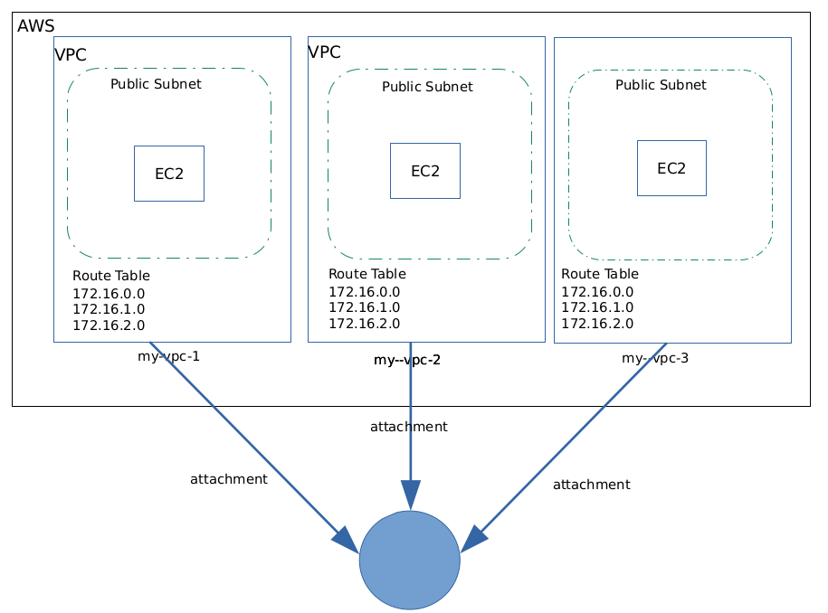

# Creating an AWS Transit Gateway Connecting N VPCs 
| Syntax | Description | 
| ----------- | ----------- |
| Created | 20.October.2026 |
| Usecase | Creating an AWS Transit Gateway Connecting N VPCs |

Steps:

1. create: my-vpc-1 with CIDR 12.0.0.0/16
2. create: subnet inside my-vpc-1
3. create: EC2 Instance inside public subnet
4. create: routing table for subnet
5. create: my-vpc-2 with CIDR 13.0.0.0/16
6. create: subnet inside my-vpc-2
7. create: EC2 Instance inside public subnet
8. create: routing table for subnet
9. create: my-vpc-3 with CIRD 14.0.0.0/16
10. create: subnet inside my-vpc-3
11. create: EC2 Instance inside public subnet
12. create: routing table for subnet
13. create Transit gateway
14. associate trnasite gateway with VPC
15. create attachments between transit gateway and vpc1 vpc2 and vp3
