# Customer managed and Inline Policy Creation
| Syntax | Description | 
| ----------- | ----------- |
| Created | 15.October.2026 |
| Prerequisite | a test user with no prior permission
| Policy1: Customer managed | a user should get s3 bucket all rights (there are about 476 different actions for s3 bucket) |
| Policy2: Inline Policy | a user get only ec2.Describe* rights. That means, he can not create/delete an ec2 Instance |


go to Policies and click on create policy

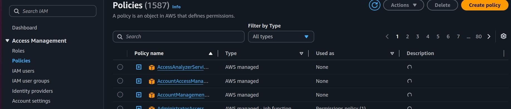


from select service, select s3

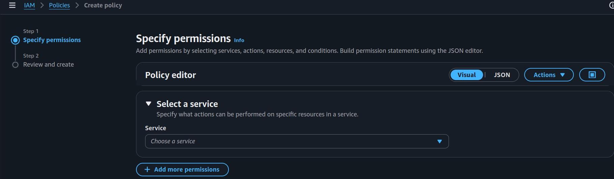


Select checkbox “All S3 actions(s3:*)
Effect: Allow
Resource: All
click next

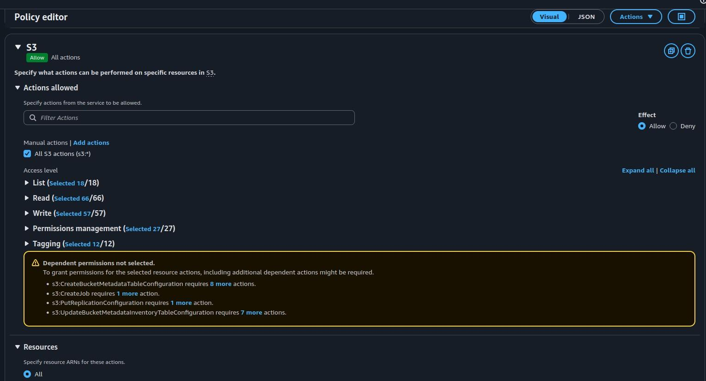


give policy a name → select create policy button

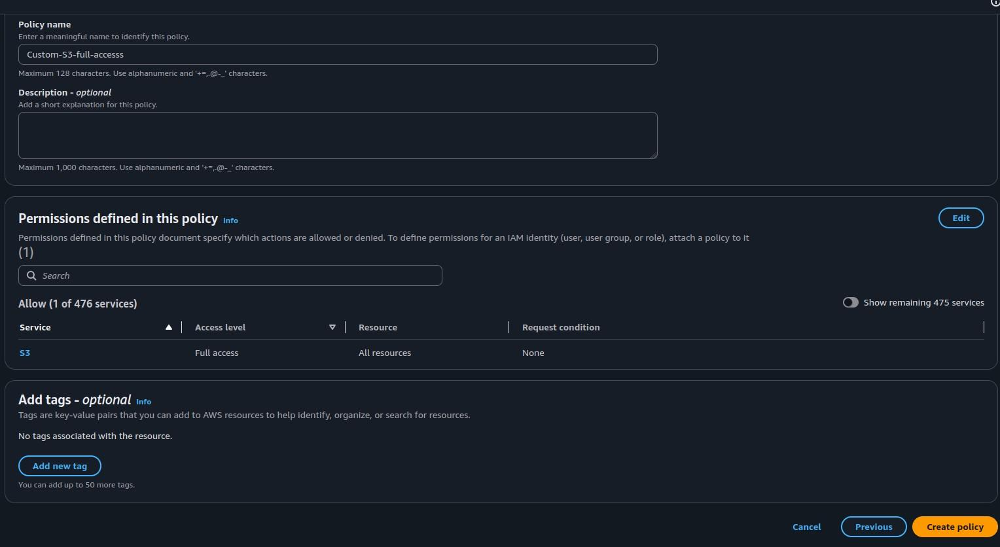


Now search this policy

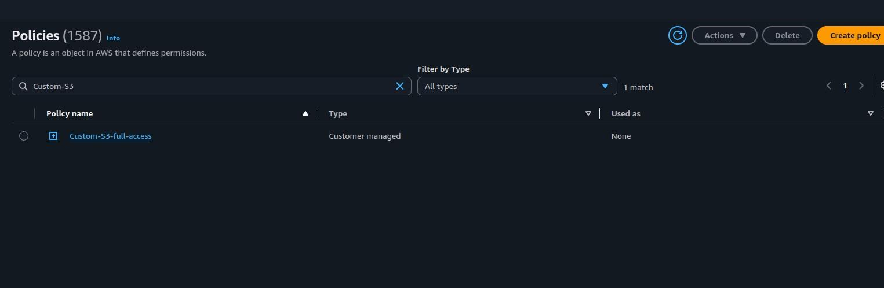

```

open the policy and click on JSON Button (right top)
{
  "Version": "2012-10-17",
  "Statement": [
    {
      "Sid": "VisualEditor0",
      "Effect": "Allow",
      "Action": "s3:*",
      "Resource": "*"
    }
  ]
}

```

Now go to Policies → search this “Custom-S3-full-access” Policy. Select this
Custom-S3-full-access policy radio button and open Action Button list and select
“attach” and select test-user. Now this policy is attached to test-user

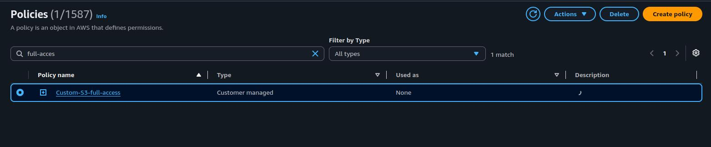

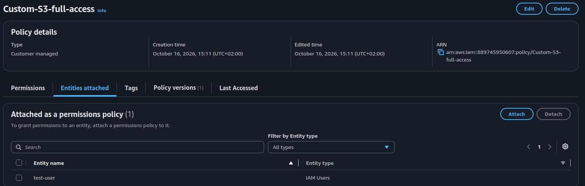


Now create one Inline Policy:
go to IAM User → test-user → Persmission → Add permission → Inline Policy → Policy
Editor:

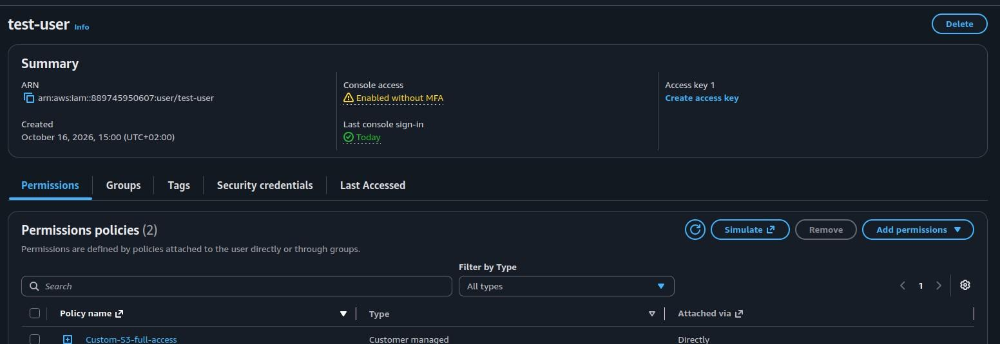

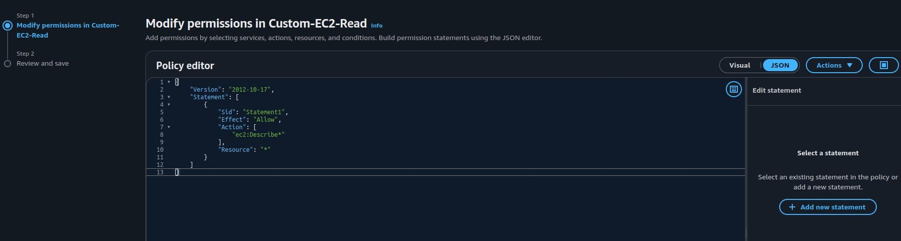

```

{

  "Version": "2012-10-17",
  "Statement": [
    {
      "Sid": "Statement1",
      "Effect": "Allow",
      "Action": [
        "ec2:Describe*"
      ],
      "Resource": "*"
    }
  ]
}

```

Now login with test-user and try:
1. create a bucket → [Expected Result] → test-user can create S3 Bucket
2. create a EC2
→ [Expected Result] → test-user is not able to create ec2 instance
EC2 launch not allowed


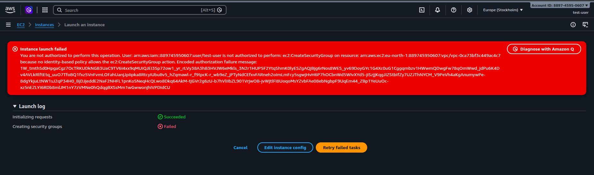


S3 Bucket creation successful

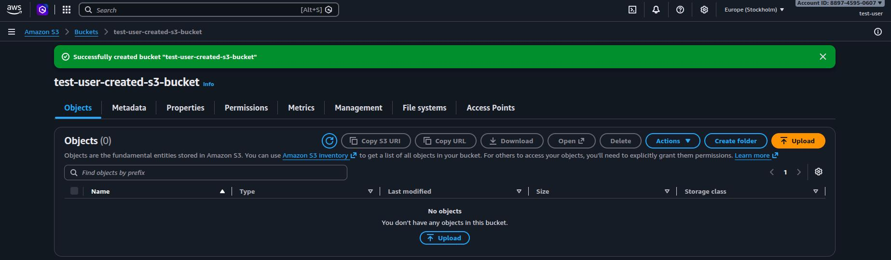


