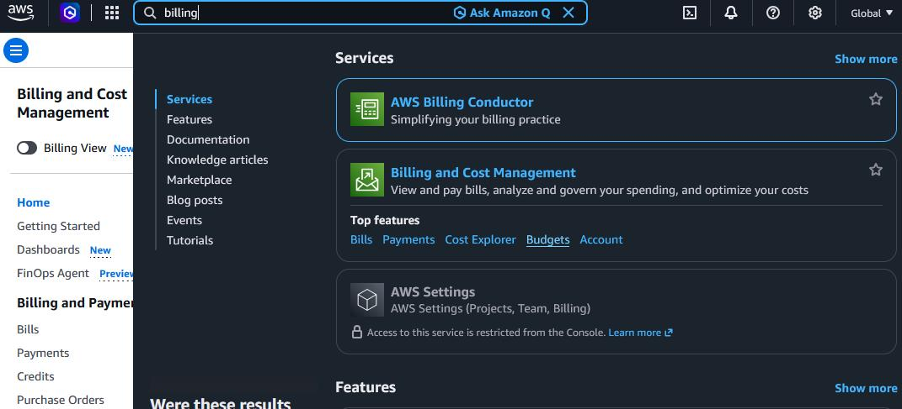
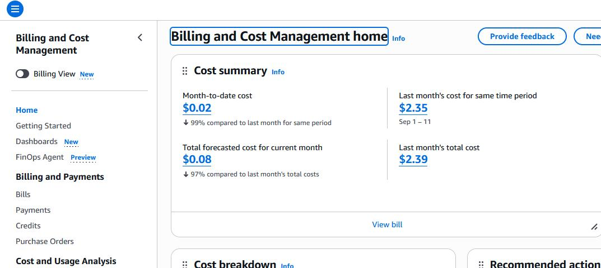
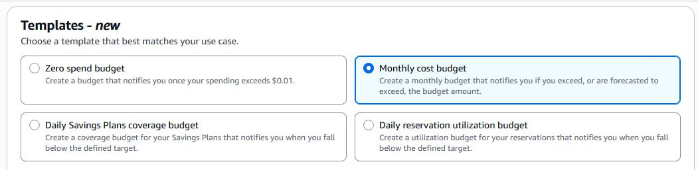
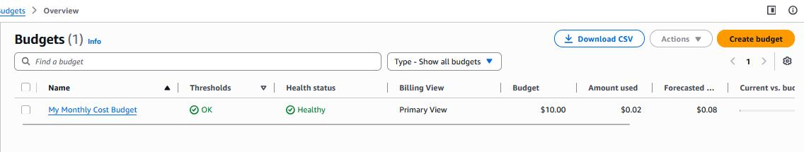

# Setting up cost budget:
| Syntax | Description |
| ----------- | ----------- |
| created | 10.October.2026 |
| UseCase | In AWS, while implementing different scenarios using resource like S3 bucket or compute instances, often the cost of those resources exceeed your budget. You can define an Alarm or Email Alert, which get triggered when your the cost of your defined resources exceeds the limit you defined | 

with the cost budget, you can specify an amount and email address and setup a Email alarm. After
you start using aws services, once your expense reach near to full
Billing and Cost Management → Budgets
a. Use a Template → Monthly cost Budget:

